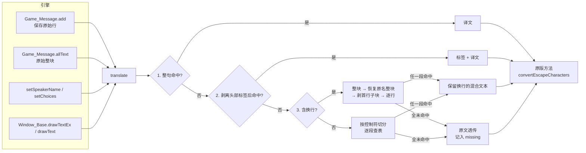
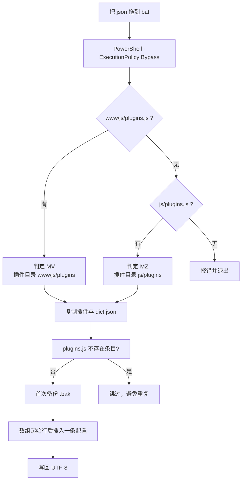

# QuickTranslator 技术架构与踩坑复盘

> 一份写给技术玩家的实现说明：为什么是 45.4 KB，为什么必须在 `convertEscapeCharacters` 之前动手，以及那些让游戏黑屏、让脚本静默失效的坑。

- 运行环境：RPG Maker MV / MZ 的 Windows NW.js 桌面版
- 代码规模：`QuickTranslator.js` 39,947 B + 安装脚本 6,533 B = **46,480 B**
- 依赖：仅 NW.js 内置 `fs` / `path`

---

## 1. 设计目标与约束

| 目标 | 手段 | 代价 |
| --- | --- | --- |
| 不注入进程 | 纯游戏内插件，挂在 5 个引擎方法上 | 只能覆盖走这些方法的文本 |
| 完全离线 | 字典 = 本地 JSON 对象 | 需要自备字典，无内置机翻 |
| 可逆 | 安装前备份 `plugins.js`，卸载还原/行过滤 | 需要读写游戏目录 |
| 零常驻 | 无定时器常驻（只有收集用的 800 ms 去抖）、无服务进程 | 无 |
| 保住控制符 | 在转义前拦截，按标签切分时保留标签 | 匹配逻辑必须理解标签语法 |
| 不碰存档 | 只改运行期字符串与两个独立 JSON | 无 |

明确的**非目标**：修改器、机翻、OCR、图片文字、非 NW.js 打包（网页版/手机版）、不经过 `Window_Base` 的自绘文本。

---

## 2. 运行期架构



关键点：所有替换都发生在 `translate()` 里，`translate()` 永远在原版方法**之前**返回字符串。原版的 `convertEscapeCharacters` 仍然照常工作，只是它拿到的已经是中文。

### 2.1 钩子清单

| 被钩方法 | 拦截目的 | 参数处理 |
| --- | --- | --- |
| `Game_Message.prototype.add` | 剧情文本：进入状态前替换，并保存未变脏的原始行 | `slice(arguments)` 后只改第 0 个，其余透传；收集延后 |
| `Game_Message.prototype.allText` | 多行整块：优先用原始行整体查表 | 缓存整块结果，`add`/`clear` 时失效 |
| `Game_Message.prototype.clear` | 重置消息状态与整块缓存 | 调用原方法后清空 `_qtSourceTexts` |
| `Game_Message.prototype.setSpeakerName`（仅 MZ 存在） | 说话人名：名字框按译文测宽 | 只替换 name |
| `Game_Message.prototype.setChoices` | 选项：选项框在 `drawTextEx` 之前就已测宽 | 逐项 `map`，非字符串原样保留 |
| `Window_Base.prototype.drawTextEx` | 帮助/描述/带标签文本 | **全参数透传**，包含 MZ 的第 4 个 `width` |
| `Window_Base.prototype.drawText` | 道具名、菜单等无标签文本 | 全参数透传 |
| `Window_Base.prototype.convertEscapeCharacters` | 标记 `\N[x]` 展开后的译文来源 | 只标记，不替换 |
| `DataManager.onLoad` / `extractSaveContents` | `$dataActors` / `$gameActors` 角色名 | 数据层就地替换，`\N[x]` 展开前生效 |
| `Game_Actor.prototype.name/nickname/profile` | 老存档里的日文人名兜底 | getter 返回值翻译，不写存档 |

为什么必须钩 `add` 而不是只在 `drawTextEx` 里翻译？因为 MZ 的消息窗口高度、名字框宽度、选项框宽度是在**写入状态后、绘制前**用 `measureTextEx` 算出来的。如果等到绘制时才把日文换成中文，布局已经按日文字宽定死了 —— 中文更宽就会被截断。同理，`setChoices` 必须在选项进入状态时翻译。`add` 逐行翻译后，`allText` 仍用 `_qtSourceTexts` 里的原始行做整块匹配，避免首行（常见为说话人名）先变成中文导致多行字典键失配。

### 2.2 幂等：`translated` + `alias`

`Game_Message.add` 翻译后的中文会再次经过 `drawTextEx`，`\N[x]` 还会把译文里的占位展开成运行期人名。如果译文恰好又出现在字典的某个键里，就会发生链式替换（中文 → 另一条中文）。插件维护：

- `translated`：本插件产出的所有译文；多行译文会拆成每一行分别记录，二次进入直接原样返回；
- `alias`：译文 → 原始日文，用于说话人名已被翻译后还原 `"日文名\n日文正文"` 再查整块；
- `actorNameControls`：角色名 → `\N[id]`，把展开后的人名规范回控制符，识别“中文译文 + 日文人名”的半成品行；
- `convertEscapeCharacters` 钩子：输入已被处理时，把 `\N[x]` 展开后的结果也加入 `translated`。

这同时避免已翻译文本、中文译文、`\N[x]` 展开结果被误收进 `missing.json`。

### 2.3 字典与路径

```text
dict.json 搜索顺序（去重后依次尝试）:
  1. 插件所在目录（document.currentScript 解析）
  2. <root>/js/plugins
  3. <root>
  4. <root>/..
  5. process.cwd()
```

`root` 由 `window.location.href` 反推：`file:///C:/Game/www/index.html` → `C:/Game/www`，并对 Windows 的 `/C:/...` 前导斜杠做了剥离。字典解析用 `Object.create(null)`，避免 `__proto__` / `constructor` 这类键在原型链上误命中。顶层必须是对象，否则直接拒绝加载（防止把数组或字符串当字典用）。

`missing.json` 写在**实际找到字典的那个目录**；如果一份都没找到，退化为第一个存在的候选目录，最后兜底 `process.cwd()`。

---

## 3. 多级匹配的可执行语义

```js
// 一级：字典键就是带标签的完整原文
translate('\\C[18]魔王\\C[0]が復活した！')  // dict 直角命中

// 二级：剥头部标签，主体查表，命中再拼回
LEAD_TAGS_RE = /^(?:\\[A-Za-z]+(?:\[[^\]]*\])?)+/
'\\SP[normal]よくぞ参った。' → prefix='\\SP[normal]', body='よくぞ参った。'
命中 → prefix + 译文

// 三级：保留组切分，奇偶索引区分标签与文字
TAG_SPLIT_RE = /(\\[A-Za-z]+(?:\[[^\]]*\])?)/
'\\c[18]魔王\\c[0]が復活' → ['', '\\c[18]', '魔王', '\\c[0]', 'が復活']

// 四级：多行文本按 \n 降级
'北海道长尾山雀\n「ここは役所です。\nどのような手続きをご希望ですか？」'
  1. 整块查表（用 alias 把已翻译的人名还原成日文后再查一次）
  2. 剥掉首行，剩余连续多行子块整体查表
  3. 最后一个控制符之后的整块查表（前缀单独翻译后拼回）
  4. 逐行查表，最后按 \n 重新拼合

// 五级：控制符后缀整块（MTool 键里不含控制符）
'「ここが\\n[1]さんのお家です♡\nさっそく…'
  dict 键 = 'さんのお家です♡\nさっそく…'（最后一个控制符之后）
  前缀 '「ここが' + 控制符 '\\n[1]' 分段翻译后原样拼回
```

键匹配比较前会先把控制符字母统一成大写（`\\n[1]` → `\\N[1]`），与 MV 的 `/gi`
展开和 `obtainEscapeCode().toUpperCase()` 保持一致；`〜`（U+301C）与 `～`（U+FF5E）
只在精确匹配失败后兜底。`translated` / `alias` 同样按规范化形式记录，避免
`\n[1]` 与 `\N[1]` 之间来回二次翻译。

控制符分段有三个容易写错的细节，都已在实现中处理：

1. **捕获组必须是整组**：`split` 只有带捕获组时才会把标签留在结果里；不带捕获组标签会被吃掉。
2. **奇数索引是标签**：切分后标签固定落在奇数位，直接 `continue` 跳过；文字段才查表。
3. **首尾空白回退**：文字段可能带空格（`" 魔王 "`），先按原样查，再按 `trim()` 查，命中后仍替换原位置，不改变空白。

另外，两种分段的收集策略不同：

- **控制符分段**：任一段命中就不再收集整块，避免 MTool 碎片字典被反复误报；未覆盖的段保留日文。
- **换行分段**：局部命中时，未命中的连续日文行仍必须收集。首行 `"女神"` 命中不能吞掉第 2-4 行正文；只有整块完全译出（不存在未译日文行）时才把完整译文加入 `translated`。
- 收集只接受原始完整行/多行子块（含行首空格），绝不记录译文拼接串或控制符碎片。
- `add` 阶段延迟收集；`allText` 负责整块判定，未走 `allText` 的路径由 800 ms finalize 定时器与 `beforeunload` 兜底。

最后还有一层“整句首尾空白”回退，处理 `" 勇者 "` 这种纯空白包裹的情况；多行候选也会逐行 `trim()` 后重试，兼容 `" 「わあ…"` 这类行首空格。

---

## 4. 未翻译文本收集

| 设计 | 原因 |
| --- | --- |
| `value === key` 不建表 | MTool 未翻译条目会把原文回填，不能当成译文，否则既不翻译也不收集 |
| `MTool_Meta_*` 键忽略 | 导出元信息不是游戏文本 |
| `JP_RE` 只放行假名/日文专有符号 | 中文译文、纯汉字、CJK 标点（`「」。、`）不再被误判成日文 |
| 先剥控制符再看长度 | 纯标签串（如 `\C[0]\C[1]`）与单字符碎片（如 `"を"`）不收集 |
| `Set` 去重 + 已翻译键/已产出译文跳过 | 同一句话在一场战斗里可能被绘制数千次 |
| 收集延后到 `allText`，且原始行块先做整块/子块查表 | 多行消息不会被 `add` 拆成碎片误收，也不会被逐行占位短路整块译文 |
| 800 ms 去抖合并写 | 避免逐句 `writeFileSync` 造成掉帧 |
| `beforeunload` 强制 `flush()` | 去抖窗口内关游戏不丢数据 |
| 写失败时把 `dirty` 置回 | 磁盘只读/占用时下个周期自动重试 |
| 旧 `missing.json` 读入后剔除已进字典的键 | 词表越跑越干净，不会无限膨胀 |

代价是“纯汉字、无假名”的日文句子不会被自动收集。这类文本无法与中文可靠区分，按需求选择宁可不收，也不把中文译文反复写进词表。补译时直接按游戏内文本手工添加即可。

---

## 5. 安装/卸载链路



卸载时优先用 `.bak` 覆盖还原；没有备份则按行过滤。部署的字典一共三份（游戏根、MV 的 `www\`、插件目录），对应插件多目录搜索策略，避免“换了路径就找不到字典”。

---

## 6. 踩坑实录

### 6.1 控制符提前展开，导致全量失配

**现象**：字典键写 `\C[18]魔王`，游戏里永远匹配不到；或者匹配到了，但颜色、人名变量的位置全部错乱。

**根因**：引擎在 `drawTextEx` 内部先调用 `convertEscapeCharacters`，把 `\N[1]` 展开成角色名、`\C[18]` 转成内部状态。翻译层如果在这之后介入，字典里的原文形态已经不存在了。

**修复**：把翻译提前到 `Game_Message.add`（消息写入状态之前）与 `Window_Base.drawTextEx` 的**入口**（原方法调用之前）。对 `drawTextEx` 来说，`translate` 的返回值再交给原逻辑转义，控制符一个都不碰。

**验收标准**：含 `\C[x]` 的句子译文出现，且颜色分段与原文一致；`\N[1]` 显示为当前角色名而不是字面量。

**教训**：文本管线里，**顺序就是正确性**。先找“最早能看到原文的钩子”，再谈匹配算法。

---

### 6.2 MTool 字典碎片化，带颜色的关键句整句漏翻

**现象**：普通对话都翻了，但凡是句中出现 `\c[18]`、`\c[0]` 的句子一律保持日文 —— 恰恰是剧情高潮、技能名、重点提示这类带高亮的句子。

**根因**：MTool 导出的字典常以颜色标签为界，把一句话拆成多个独立条目，例如：

```text
"\\c[18]魔王"      : "\\c[18]魔王"
"\\c[0]が復活した！" : "\\c[0]复活了！"
```

游戏里整句是 `\c[18]魔王\c[0]が復活した！`，整句查表必然落空；而只做整句匹配的实现不会去看被切碎的条目。

**修复**：三级降级中的第三级 —— 用保留组正则按控制符切分，标签原样保留、文字段逐段查表、最后顺序拼合。

**验收标准**：上述句子输出 `\c[18]魔王\c[0]复活了！`，控制符个数与顺序与原文完全一致。

**教训**：字典是别人产的，**不能假设它的切分粒度**；匹配器要比字典更懂得“句子”的结构。

---

### 6.3 `\SP[...]` 等头部插件标签导致失配

**现象**：带立绘表情/插件指令的对话框整句不翻译，去掉头部标签后的正文明明在字典里。

**根因**：`\SP[normal]`、`\FS[24]` 这类标签在原句最前面，字典键通常只存正文或只存部分标签，整句精确匹配失败。

**修复**：二级匹配 —— `^(?:\\[A-Za-z]+(?:\[[^\]]*\])?)+` 连续吞掉所有头部标签，主体（必要时 `trim()`）查表，命中后 `prefix + 译文` 拼回。

**验收标准**：`\SP[normal]よくぞ参った。` → `\SP[normal]你终于来了。`，立绘表情仍按原逻辑触发。

**教训**：头部标签是“元数据”，不该参与语义匹配，但**必须原样带回**。剥离与还原要成对设计。

---

### 6.4 全局正则改 `plugins.js`，直接黑屏（Syntax Error）

**现象**：安装完成，启动 `Game.exe` 黑屏，开发者工具报 `plugins.js` 语法错误。卸载后恢复正常。

**根因**：最初想用 `-replace "\["` / `-replace "\{"` 之类的全局替换在数组里插配置。但 `plugins.js` 里除了 `$plugins = [` 之外，每个插件的 `parameters` 中还有大量数组与对象字面量（`"data": [1,2]`、`"columns": {...}`）。全局替换会把这些中括号改成别的东西，文件当场不合法。

**修复**：放弃正则替换，改为**按行手术**：

1. `[System.IO.File]::ReadAllLines(..., UTF8)` 读入行数组；
2. 先扫一遍是否已有 `QuickTranslator`（幂等，重复安装不重复插入）；
3. 找到数组起始行（标准格式中即 `var $plugins =` 下方那一行单独的 `[`），在该行**之后**插入一条完整配置行；
4. `WriteAllLines(..., UTF8)` 写回。

配置行本身用 `[char]34` 拼引号，避免 PowerShell 字符串转义把 JSON 引号吃掉：

```powershell
$q = [char]34
$entryLine = "{" + $q + "name" + $q + ":" + $q + "QuickTranslator" + $q + "," + $q + "status" + $q + ":true,..."
```

**验收标准**：安装后 `plugins.js` 仍是合法 JS（数组元素用逗号分隔、括号配对），游戏正常启动且插件生效；重复安装不会出现两条配置。

**教训**：**结构化文件不要用全局正则改**。按行、按锚点插入，把“理解结构”的责任交给定位逻辑，而不是交给一条贪婪正则。

---

### 6.5 卸载正则遇到嵌套大括号，清不掉配置

**现象**：卸载后插件文件删了，但 `plugins.js` 里还留着配置项，游戏启动报插件缺失/配置异常；或干脆什么都没删掉。

**根因**：想用一条正则匹配整条插件配置，形如 `\{[^{}]*"name":"QuickTranslator"[^{}]*parameters\s*:\s*\{[^{}]*\}\s*\}`。而 `parameters` 自身就带大括号，.NET 正则没有递归/平衡组能力，`[^{}]*` 在嵌套结构上必然卡住。

**修复**：既然标准 `plugins.js` 每条配置独占一行，就**按行过滤**：

```powershell
$cleanLines = $rawLines | Where-Object { $_ -notmatch "QuickTranslator" }
```

同时优先走备份还原分支：存在 `plugins.js.bak` 时直接覆盖，连解析都不需要。备份只在首次安装时生成（`if (-not (Test-Path $bak))`），避免重复安装把“已含插件的状态”覆盖成新备份，导致卸载还原不干净。

**验收标准**：卸载后 `plugins.js` 中无 `QuickTranslator` 行，其余插件配置逐字节不变；再次安装可正常插入。

**教训**：**能用行级操作就别用结构级正则**。嵌套结构的解析交给解析器或行协议，正则只做“是否包含”这种线性判断。

---

### 6.6 PowerShell 5.1 编码地狱：无 BOM 的中文源码被按 GBK 读

**现象**：脚本在作者机器上正常，换一台 Windows 直接语法错误，报未闭合的字符串/单引号；错误行号指向一句中文注释或中文 `Write-Host`。

**根因**：Windows PowerShell 5.1 读取 `.ps1` 时，若无 UTF-8 BOM，会按系统 ANSI 代码页（简中为 GBK/936）解码。UTF-8 的中文字节被按 GBK 拆开，可能刚好产生 `0x27`（单引号）等 token 分隔符，后续语法全乱。而 `plugins.js` 与 JSON 又必须显式按 UTF-8 读写，否则游戏与文件双双乱码。

**修复**：

1. **所有 `.ps1` 与 `.bat` 只用 ASCII 编写** —— 输出信息、注释、变量名全英文，从根上消灭“源码编码”这一变量；
2. 需要处理 UTF-8 数据的地方显式指定编码：

   ```powershell
   [System.IO.File]::ReadAllLines($targetJs, [System.Text.Encoding]::UTF8)
   [System.IO.File]::WriteAllLines($targetJs, $cleanLines, [System.Text.Encoding]::UTF8)
   ```

3. 插件侧读字典时先剥 BOM：`.replace(/^\uFEFF/, '')`，兼容用户用记事本另存的带 BOM JSON。

**验收标准**：在任意语言的 Windows（含英文系统、日文系统）上直接双击运行，无乱码、无语法错误；中文译文在游戏内正常显示。

**教训**：跨机器分发的脚本，**ASCII 源码 + 显式 UTF-8 数据通道** 是最省心的组合。不要把“文件编码”交给宿主环境的默认值。

---

### 6.7 `UnauthorizedAccess`：默认执行策略拦下脚本

**现象**：双击 bat 后窗口一闪，提示“无法加载文件 … 因为在此系统上禁止运行脚本”。

**根因**：Windows 客户端默认 `Restricted` / `RemoteSigned`，从网络下载或从压缩包解出的 `.ps1` 会被拦截。

**修复**：bat 里显式传 `-ExecutionPolicy Bypass`，只对这一次进程生效，不改系统全局策略：

```bat
@echo off
powershell -NoProfile -ExecutionPolicy Bypass -File "%~dp0install.ps1" "%~1"
pause
```

`-NoProfile` 顺便避免用户 profile 里的函数/别名污染脚本行为。

**验收标准**：全新系统解压后直接拖拽即可运行，无需右键“解除锁定”、无需改注册表。

**教训**：面向小白的入口必须**零配置可用**；Bypass 的作用域要限定在单次进程，而不是永久放宽系统安全策略。

---

### 6.8 批处理尾反斜杠吞引号：`"%~dp0"` 是炸弹

**现象**：路径明明正确，PowerShell 却报找不到文件，或者参数被拼成一整串。

**根因**：`%~dp0` 展开后**以反斜杠结尾**（`C:\Game\`）。如果写成 `"%~dp0"` 再拼参数，命令行变成 `"C:\Game\" install.ps1`；按 Windows 命令行解析规则，`\"` 被当作转义的双引号，引号配对错位，后续全部参数被并进同一个字符串。

**修复**：不要把目录单独用引号包起来，而是把文件名直接接在后面：

```bat
"%~dp0install.ps1"
```

这样展开为 `"C:\Game\install.ps1"`，尾部没有裸露的反斜杠。拖拽时 `%~1` 同样带引号传入，含空格与中文的路径都能正常解析；用户没拖文件时 `%~1` 为空，安装器自动回退到目录内扫描 `*.json`。

**验收标准**：游戏目录含空格、含中文、位于 `D:\` 根目录等情况下均能安装成功。

**教训**：Windows 命令行里，**以 `\` 结尾的带引号路径等于把结束引号转义掉**。拼接路径时永远让文件名紧贴目录分隔符，不要留下单独的反斜杠在引号前。

---

### 6.9 空译文占位把界面刷成空白

**现象**：字典里存在待翻译占位（值为 `""`），安装后对话框、选项直接变成空白。

**根因**：把 `""` 当作合法译文返回，文本被替换为空串，UI 看起来像丢字/卡死。

**修复**：加载字典时过滤 `value === ''` 的条目（不建表、不计入条数）；这类键在运行时自然走“未命中”，保留日文并进入 `missing.json`，形成“占位 → 补译 → 生效”的闭环。

**验收标准**：字典中半成品条目不影响显示，日文原样保留，且该句出现在 `missing.json`。

**教训**：**缺失值必须与合法值区分**。空字符串在文本系统里是“删除文本”的强语义，不能拿来表示“待办”。

---

### 6.10 二次翻译链与 `Set` 膨胀

**现象**（设计阶段预判）：`add` 翻译出的中文再次进 `drawTextEx`，若译文恰好又是字典键，会被二次替换成另一条文本；`missing.json` 可能把纯中文译文当成遗漏收集。

**根因**：同一文本会流经两个钩子，且字典键不含“来源”信息。

**修复**：`translated` 集合记录本插件产出的所有译文（多行译文拆行记录），二次进入直接短路；`alias` 记录译文 → 原文，供整块回溯；`convertEscapeCharacters` 钩子把 `\N[x]` 展开后的结果同步标记；`collect()` 检查 `dict[text] !== undefined`，已翻译键永不收集。

**验收标准**：任意句子只被替换一次；反复打开菜单、`\N[1]` 展开后重新绘制都不会新增 `missing` 条目。

**教训**：多钩子共用一个转换函数时，**必须显式保证幂等**，不能依赖“译文刚好不在字典里”。

---

### 6.11 参数丢失导致 MZ 文本截断

**现象**：MV 正常，MZ 上部分文本被截断或对齐异常。

**根因**：MZ 的 `drawTextEx(text, x, y, width)` 比 MV 多一个 `width` 参数；早期包装只取了第 0 个参数再调用原方法，宽度丢失。

**修复**：所有钩子统一 `var args = Array.prototype.slice.call(arguments)`，只替换 `args[0]`，再 `apply(this, args)`。名字、选项则在状态层替换，让测量发生在译文上。

**验收标准**：MZ 中长句自动换行、名字框宽度贴合中文、选项框不裁字；MV 行为不变。

**教训**：写 monkey patch 时，**参数列表属于契约**。`slice + apply` 是最便宜的兼容层，不要手抄签名。

---

### 6.12 去抖写盘丢数据与噪音爆炸

**现象**（设计阶段预判）：高速跳过对话时逐句写 `missing.json` 掉帧；直接关游戏导致最后一批遗漏丢失；`missing.json` 里塞满 `\V[1]`、数字、英文。

**根因**：写盘没有合并、没有退出钩子；收集器没有文本质量过滤。

**修复**：800 ms 去抖 + `dirty` 标记 + `beforeunload` 同步 `flush()`；`JP_RE` 只放行含假名/日文专有符号的文本；剥掉控制符后为空或长度不足则不收集；写盘失败回滚 `dirty` 以便重试。

**验收标准**：帧率无可感知变化；关闭窗口后重新打开，`missing.json` 包含关闭前最后出现的句子；文件中无纯数字/纯英文条目。

**教训**：日志类旁路功能必须**默认低成本**：合并写、按需写、退出兜底。

---

### 6.13 `file://` 路径与多目录搜索

**现象**：插件加载了字典，但 `missing.json` 写到了奇怪的位置；或插件目录里有字典却报“未找到”。

**根因**：NW.js 中 `window.location.href` 是 `file:///C:/...` 形式，直接 `path.resolve` 会得到 `C:\...` 与 `/C:/...` 两种形态；MV 的根是 `www`、MZ 的根是工程目录，插件相对位置也不同。

**修复**：统一经 `new URL(url).pathname` + `decodeURIComponent` 转本地路径，正则 `/^\/[A-Za-z]:/` 剥掉盘符前的斜杠；然后把插件目录、`<root>/js/plugins`、`<root>`、`<root>/..`、`cwd` 去重排队，逐个探测 `dict.json`；`missing.json` 永远写在**字典实际所在目录**。

**验收标准**：MV/MZ、含空格中文路径、字典放在插件目录或游戏根目录，均能正确加载并写出 `missing.json`。

**教训**：Windows + `file://` 的组合，**必须先归一化再谈相对路径**。

---

### 6.14 重复安装的幂等性与备份污染

**现象**（设计阶段预判）：玩家多次拖拽字典，`plugins.js` 出现多条 `QuickTranslator`；或第二次安装覆盖了 `.bak`，卸载时还原到“已含插件”的版本。

**根因**：插入逻辑缺少存在性检查；备份无条件覆盖。

**修复**：插入前逐行扫描 `-match "QuickTranslator"`，已存在则跳过并提示；备份仅在 `.bak` 不存在时创建。

**验收标准**：连续安装三次，`plugins.js` 中仅一条配置；卸载后与原版一致。

**教训**：安装器是**可重复执行**的幂等操作，不是一次性脚本。

---

### 6.15 多行对话被逐行翻译污染，整块键失配且误收集

**现象**：`missing.json` 出现

```text
"北海道长尾山雀\n「ここは役所です。\nどのような手続きをご希望ですか？」": ""
```

首行说话人名已经是中文，后面两行日文却完全没命中；另一段已是中文的多行对话也被重复收集。

**根因**：

1. `Game_Message.add` 是**逐行**调用的，说话人名或首行先被翻译后，`allText()` 拼出来的已经不是字典里的原始日文多行键；
2. 旧实现只在单行维度做“整句 → 剥标签 → 按控制符分段”，没有按 `\n` 的降级，整块多行键失配后直接把拼接结果写进 `missing.json`；
3. `\N[1]` 在 `convertEscapeCharacters` 里被展开成日文角色名，展开后的中文串不在 `translated` 集合里，`drawTextEx` 再进来时被当成新文本收集。

**修复**：

1. `add` 额外保存未变脏的原始行，收集延后；`allText` 优先对原始多行块整体查表；未调用 `allText` 的路径由 800 ms finalize 定时器与 `beforeunload` 兜底；
2. 多行文本增加降级链：整块 → 用 `alias` 恢复已翻译人名后的整块 → 剥首行后的连续多行子块 → 逐行，始终保持 `\n`；整块与子块查表都会逐行 `trim()` 重试，兼容 `" 「わあ…"`；
3. 局部命中时，未命中的连续日文行照常 `collect()`（首行 `"女神"` 命中不再吞掉 2-4 行正文）；只有不存在未译日文行时才把完整译文加入 `translated`；
4. `translated` 拆行记录、`alias` 反向映射、`convertEscapeCharacters` 同步标记展开结果；角色名规范化为 `\N[id]` 后可识别“中文译文 + 已展开人名”的半成品行，避免误收；
5. `$dataActors` / `$gameActors` 的角色名在数据层翻译，`\N[1]` 不再展开出日文人名。

**验收标准**：上述多行条目要么整块命中译文，要么保持日文；`missing.json` 不再出现“中文人名 + 中文译文”的拼接条目，但首行命中后剩余日文正文必须进 `missing.json` 并实际写盘。

**教训**：**状态层的逐行替换和渲染层的整块匹配是两套视角**。前者为布局服务，后者才是字典键的真实粒度；两边必须共享一份未变脏的原始文本。

---

### 6.16 `JP_RE` 把中文汉字当日文，`"を"` 碎片混入词表

**现象**：完全不含假名的中文译文（如 `"北海道长尾山雀\n「那么，请将新的姓名\n填写在这张表格上」"`）进了 `missing.json`；同时出现单字符条目 `"を"`。

**根因**：

1. 旧 `JP_RE` 把 CJK 统一表意文字（`\u4e00-\u9fff`）与 CJK 标点（`\u3000-\u303f`）也算作日文，中文译文因此被误判；
2. `"を"` 不可能由分段匹配产生 —— 第三级只替换命中的段，未命中的段不单独收集，`collect()` 只接收整条原文。它只能来自游戏/插件把 `"を"` 作为独立参数传入 `drawText` / `drawTextEx`（逐字绘制、逐字测宽类插件常见），旧逻辑把整条单字符文本当成待翻译句子收集。

**修复**：

1. `JP_RE` 只保留平假名、片假名、`ー`、`々〆〻` 与半角片假名；CJK 标点与通用汉字不再命中；
2. 分段匹配继续执行“任一段命中即不收集整块、碎片不收集”；
3. 收集前剥控制符并做最小长度检查，单字符片段（如 `"を"`）直接忽略；它仍然会走翻译查找，只是不写 `missing.json`。

**验收标准**：纯中文/纯汉字/`「」。、` 不产生条目；`"を"` 不再出现；包含假名的真实日文句子仍能收集。

**教训**：**“含汉字”不等于“是日文”**。语言判定必须找区分性字符（假名），而不是最大交集（汉字）。

---

### 6.17 MTool 原文回填占位：既不翻译也不产生 `missing.json`

**现象**（真实游戏 `エターナル子作りファンタジー`，MV 1.6.2）：

- 开场女神对话 `「わあ～♡ありがとうございます～！` 所在的消息整段保持日文；
- `dict.json` 里明明存在这段 3 行正文的中文译文；
- 整场游戏跑下来 `missing.json` 根本不生成。

**排查**：用真实 `rpg_core/objects/windows`、`plugins.js` 中全部 20 个启用插件、真实 `dict.json` 与 `Map018.json` 的事件命令在 Node 里复现。字典共 26,919 条，其中 **9,560 条 `value === key`**：MTool 导出未翻译条目时会把原文原样写回译文，而不是写 `""`。另有 1 条 `MTool_Meta_DO_NOT_REMOVE {...}` 元信息。

失效链路：

1. 加载时把 `value === key` 当成合法译文，全部进表（26,919 条）；
2. `Game_Message.add` 对每一行 `401` 逐一查表，日文原文行全部“命中”并加入 `translated`；
3. `Window_Message.startMessage` → `Game_Message.allText` 拼出原始多行块，`translate` 开头的 `isProcessedComposite` 看到“每一行都已翻译”，直接短路返回日文；
4. 真正的 3 行整块译文永远轮不到；同理，所有行都“已翻译”，`collect` 没有可收集项，`missing.json` 永远为空。

**修复**：

1. 加载字典时跳过 `value === key` 的条目，只把真正的译文建表；`MTool_Meta_*` 键一并忽略。日志明确打印“跳过 N 条未翻译占位”。
2. `Game_Message.allText` 取得**原始行块**后，先走整块/剥首行子块查表（`translate(..., false, true)`），不允许 `isProcessedComposite` 在整块查表前短路；逐行结果只作为后续降级。
3. `QT_DEBUG` 开关：日志直接追加到 `<游戏根>/qt_debug.log`（根目录不存在时退到字典目录），不依赖 F8 Console。

**验收标准**：

- 真实开场事件的三段目标文本按 `dict.json` 的多行键显示中文；
- 同一批文本不再产生 `missing.json` 噪音；
- 人为加入一条字典缺失的日文消息，`missing.json` 正常出现且只包含该原始多行块；
- 原有 14 项回归测试 + 新增 2 项 MTool 占位测试全部通过。

**教训**：**“查得到”不等于“有译文”**。MTool 的原文回填占位、空字符串、普通译文必须分成三种状态；任何以“行已命中”为依据的短路，都要先确认命中的不是原文本身。

---

### 6.18 MTool 把控制符从键里剥掉，多行键从“最后一个控制符之后”开始

**现象**（同一份真实字典）：

- 事件原文 `「ここが\n[1]さんのお家です♡`，`dict.json` 的键却是 `さんのお家です♡\nさっそく…`；
- `さん♡まあ、なんて素敵なお名前♡` 这类键在 `dict.json` 里存在，但游戏里永远不命中；
- 这 3 句被写进 `missing.json`，但字典里明明有译文。

**排查**：扫描 26,919 条键，**没有任何一条包含 `\n[x]` 或 `\N[x]`** —— MTool 导出时把控制符从键里剥掉了。逐事件对比后确认键的起点是**最后一个控制符之后**：控制符之前的文字另有独立键（如 `「ここが` → `「这里就是`），控制符之后的整块（含后续行）才是多行键。全量 16,186 个消息块里，有 2,914 块只能靠这种“后缀整块”命中。

**修复**：

1. 查表前把控制符字母统一大写（`\n[1]` / `\N[1]` 等价），`dict` 额外建规范化索引；`translated` / `alias` 也存规范化形式，避免二次翻译。
2. 多行降级链新增“最后一个控制符之后的整块”：前缀单独按分段/逐行翻译，控制符原样保留，后缀整块查表后拼合；`missing.json` 只记录真正没翻到的前缀。
3. 波浪线 `〜` / `～` 差异做同样的兜底索引。

**验收**：全量模拟前后，`missing.json` 从 1,866 条降到 306 条（剩余均为真实源文），3 个目标句全部命中；半成品译文拼接串不会再被写进词表。回归测试新增 6 项。

**教训**：**导出的键不一定保留运行期控制符**。遇到“字典明明有、游戏就是不命中”，先把键和运行时原文逐字符 diff，再谈模糊匹配。

---

### 6.19 `GameFont`（mplus）缺简体字，canvas 画成空白

**现象**：中文译文里的「异」「您」在消息框里显示为空格，但同一个字在浏览器/记事本里正常。

**原因**：`Window_Base.prototype.standardFontFace` 只有在 `$gameSystem.isChinese()`（locale 以 `zh` 开头）时才返回 `SimHei` 等中文字体；日文游戏 locale 是 `ja_JP`，返回 `GameFont`。`GameFont` 指向 `mplus-1m-regular.ttf`，只覆盖日文字形，缺简体字时 canvas 不报错、直接画空白。

**修复**：插件加载时覆盖 `standardFontFace`，返回中文字体优先的字体栈：

```js
'"Microsoft YaHei", "PingFang SC", "Hiragino Sans GB", "Noto Sans CJK SC",
 "Source Han Sans SC", "SimHei", "Heiti TC", "Microsoft JhengHei", "GameFont", sans-serif'
```

`Bitmap._makeFontNameText()` 拼出的是 CSS `font` 简写（`28px "Microsoft YaHei", …`），CSS 会按字形逐个回退；`GameFont` 排在后面只负责假名。字体栈是文件顶部 `CJK_FONT_FACE` 常量，玩家可换成自己系统里有的字体。

**教训**：**“字显示成空白”先查字体覆盖范围**。`GameFont` 是日文字体，不是全 CJK 字体；翻译插件不能假设系统会自动回退到中文字形。

### 6.20 读档失败：`JsonEx` 把空角色槽位还原成 `null`

**现象**：新游戏、存档正常，读档一律失败（`Scene_Load` 走 `onLoadFailure` / 提示读档失败）；从 `js/plugins/` 移除 `QuickTranslator.js` 后立刻恢复。

**原因**：`$gameActors._data` 是以角色 ID 为下标的稀疏数组，未入队角色的槽位在 `JsonEx.stringify` 时被写成 `null`，`JsonEx.parse` 解码后仍是 `null`（不是 `undefined`）。插件在 `DataManager.extractSaveContents` 之后遍历角色时先取 `data[i]._actorId` 再判空：

```js
translateActorEntry(data[i], GAME_ACTOR_FIELDS, data[i]._actorId || i); // null 时 TypeError
```

真实存档 `file1.rpgsave` 的 71 个槽位里有 39 个 `null`，第一个空洞在索引 7，因此每次读档都抛：

```
TypeError: Cannot read properties of null (reading '_actorId')
    at translateGameActors (QuickTranslator.js:901)
    at DataManager.extractSaveContents (QuickTranslator.js:920)
```

该异常发生在 `DataManager.loadGameWithoutRescue` 内部，被 `DataManager.loadGame` 的 `try/catch` 吞掉并 `return false`，控制台只留下一条错误，游戏表现为“读档失败”。

**修复**：取 `_actorId` 前先判空，`null` / `undefined` / 稀疏空洞一律跳过：

```js
for (var i = 1; i < data.length; i++) {
    var actor = data[i];
    if (!actor || typeof actor !== 'object') continue;
    translateActorEntry(actor, GAME_ACTOR_FIELDS, actor._actorId || i);
}
```

**教训**：**读档链路上任何遍历都要按“存档里可能是 `null`”写**。`DataManager.loadGame` 的 `try/catch` 只返回 `false`，不区分“文件不存在”和“插件抛异常”；排查读档问题时必须直接调用 `loadGameWithoutRescue` 或复现 `extractSaveContents` 才能看到真实堆栈。回归测试覆盖真实存档读档、读写往返与 `Scene_Load.onSavefileOk`（见 `test/quicktranslator.test.js` 场景 15–18）。

---

## 7. MV / MZ 差异对照

| 差异点 | MV | MZ | 处理 |
| --- | --- | --- | --- |
| 工程结构 | `www/js/plugins.js` | `js/plugins.js` | 安装器按路径探测顺序判定 |
| `drawTextEx` 签名 | `(text, x, y)` | `(text, x, y, width)` | `slice + apply` 全参数透传 |
| 说话人名字 | 无 `setSpeakerName` | 有该方法，写入消息状态 | 存在性检测后挂钩 |
| 名字/选项测宽 | 同左，按状态文本测量 | 同左 | 在 `setSpeakerName` / `setChoices` 翻译 |
| 运行期探测 | 均有 `require` / `process` | 同左 | 缺失即静默停用，不报错 |

---

## 8. 已知限制与剩余风险

1. **只覆盖经过钩子的文本**。自绘插件、直接操作 `Bitmap` 的画面文字、图片内的文字不翻译。
2. **依赖 NW.js**。纯浏览器调试环境（直接双击 `index.html` 用 Chrome 打开）无 `require`/`fs`，插件自动停用。
3. **字典质量决定效果**。分段匹配只能“把字典已有的碎片拼回去”，无法翻译字典里完全不存在的文字；含假名的未命中文本会原样保留并进入 `missing.json`，纯汉字文本按设计不自动收集。
4. **安装器按行定位插入点**。标准 RPG Maker 生成的 `plugins.js` 中数组起始行稳定；若被第三方工具重排成单行写法，定位会退化为“首个含 `[` 的行”，需要人工检查。
5. **卸载会删除注入产物**。若把唯一字典副本直接命名为游戏根目录的 `dict.json`，卸载时会被清理 —— 源字典请另存一份。
6. **字典键的原型污染已规避**（无原型对象），但键中的控制符需与游戏内实际文本**完全一致**（大小写、参数、空格）。
7. **字体**。日语字体通常含汉字，但简体字形可能以日式写法呈现；追求排版时请替换为包含简体字形的字体。

---

## 9. 验证方法

本方案按以下清单在实机 MV / MZ 工程上验证：

| 场景 | 观察点 |
| --- | --- |
| 基础对话 | 普通文本替换，控制台打印字典条数 |
| 带颜色重点句 | `\c[x]` 分段句子逐段翻译，标签数量与顺序不变 |
| 人名/变量 | `\N[x]` 展开为**译文**角色名，不再残留日文 |
| 多行对话 | 整块命中字典多行键；说话人名先翻译也不影响整块匹配 |
| MTool 占位字典 | `value === key` 视为未翻译；多行键仍优先于逐行占位，开场女神对话正常显示中文 |
| 诊断日志 | `QT_DEBUG = true` 时 `qt_debug.log` 记录字典路径、跳过占位数、`allText` 输入输出与写盘结果 |
| 多行局部命中 | 首行 `"女神"` 命中后，第 2-4 行日文仍进 `missing.json` |
| 非 allText 路径 | 只读 `_texts` 的插件路径也会由 finalize/`beforeunload` 写出 `missing.json` |
| 行首空格 | `" 「わあ…"` 与无空格字典键都能命中 |
| 立绘标签 | `\SP[...]` 头部标签保留且表情正常触发 |
| 中文译文回绘 | 纯中文/`\N[x]` 展开后的拼接结果不重复翻译、不进 `missing.json` |
| 单字符碎片 | `drawText("を")` 不产生 `missing` 条目 |
| MZ 名字框 / 选项框 | 按中文测宽，不截断、不溢出 |
| 未命中文本 | 日文原样显示，`missing.json` 出现且无纯数字/英文噪音 |
| 高速跳过对话 | 无卡顿；关闭游戏后遗漏不丢 |
| 读档 | 含 `null` 角色槽位的真实旧存档可读；`Game_Actor.name()` 返回译文；存档→读档往返正常 |
| 重复安装 | `plugins.js` 仅一条配置，游戏正常启动 |
| 卸载 | `.bak` 还原成功；无备份时行过滤干净；游戏回到原版 |

---

## 10. 体积与开销

| 文件 | 字节 |
| --- | --- |
| `QuickTranslator.js` | 39,947 |
| `install.ps1` | 3,957 |
| `uninstall.ps1` | 2,396 |
| `安装汉化(把json拖我身上).bat` | 92 |
| `一键卸载.bat` | 88 |
| **合计** | **46,480（≈45.4 KB）** |

运行时开销：

- 命中路径：1 次 `Object` 哈希查找 + 1 次 `Set.has`；
- 未命中路径：至多 2 条正则 + 一次 `split`（仅未命中时发生）；
- 内存：字典条目数 × 键值字符串；`translated` 集合随唯一译文数量增长；
- 无定时器常驻：去抖定时器只在有待写遗漏时存在，写盘后即清空。

---

相关文档：[README.md](README.md) —— 安装、字典格式与 MTool 对比。
